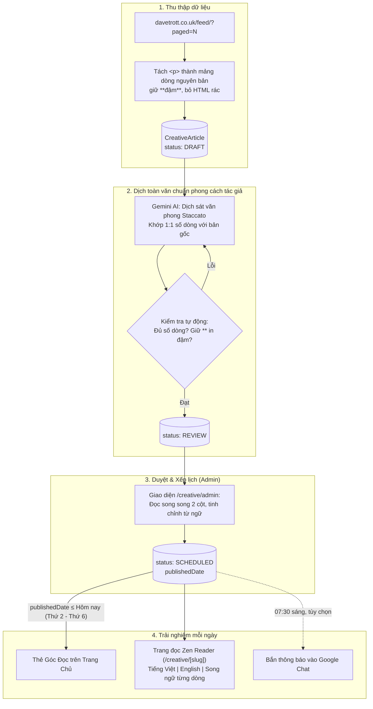

# Kế hoạch Triển khai: Góc Đọc & Cảm Hứng myCreative
> **Đọc toàn văn bài học sáng tạo từ huyền thoại quảng cáo Dave Trott (davetrott.co.uk)**
> Bản cập nhật: Tập trung 100% vào dịch thuật toàn văn chuẩn văn phong tác giả, không tóm tắt, phục vụ học tập nội bộ.

---

## 1. Mục tiêu & Tinh thần Cốt lõi

* **Trạm sạc năng lượng đầu ngày:** Mở app ra là thấy một bài học tư duy ngắn gọn, sắc bén trước khi bắt tay vào công việc. Đúng tinh thần "Hiên nhà thoáng đãng" trong `docs/DESIGN_GUIDELINES.md`.
* **Tôn trọng 100% nguyên tác của Dave Trott:** 
  * Dave Trott không viết tiểu luận hay đoạn văn thông thường; ông viết theo lối **Staccato** (câu cực ngắn, mỗi câu một dòng riêng, nhịp dồn dập như thơ tự do, kết bài bằng một cú twist bất ngờ).
  * **Không tóm tắt:** Việc tóm tắt sẽ làm mất đi cái hay, nhịp kể chuyện và sự bất ngờ của tác giả. Do đó, hệ thống sẽ **dịch toàn văn 100% từng dòng**.
* **Song ngữ Anh – Việt:** Hiển thị song song từng dòng nguyên bản tiếng Anh và bản dịch tiếng Việt, giúp đội ngũ vừa học tư duy sáng tạo/giải quyết vấn đề, vừa rèn luyện kỹ năng Copywriting tiếng Anh thực chiến.
* **Quy mô:** Sử dụng nội bộ trong công ty `myCreative` phục vụ nghiên cứu và nâng cao năng lực sáng tạo, ghi nguồn trang trọng dẫn về `davetrott.co.uk`.

---

## 2. Luồng Dữ liệu & Xử lý (Pipeline)



---

## 3. Cấu trúc Cơ sở Dữ liệu (Prisma Schema)

Lưu trữ theo định dạng **mảng dòng JSON** để bảo toàn hoàn hảo cấu trúc ngắt dòng staccato, vừa chống XSS vừa hiển thị song ngữ thẳng hàng:

```prisma
model CreativeArticle {
  id                  String           @id @default(cuid())
  slug                String           @unique
  guid                String           @unique // Mã RSS tránh trùng lặp khi cào lại
  originalUrl         String           // Link gốc bài viết trên davetrott.co.uk
  originalTitle       String           // Tiêu đề tiếng Anh gốc (IN HOA)
  originalPublishedAt DateTime?        // Ngày Dave Trott viết bài
  
  // Mảng dòng gốc: [{ "t": "Many years ago, my dad joined the police." }, { "gap": true }, { "t": "**Off you go.**" }]
  originalLines       Json
  wordCount           Int

  titleVi             String?          // Tiêu đề tiếng Việt (IN HOA)
  // Mảng dòng dịch: Khớp chính xác 1:1 số dòng và vị trí gap với originalLines
  linesVi             Json?            
  tags                String[]         @default([]) // Thẻ chủ đề: "sangtao", "tuduy", "copywriting"...

  status              String           @default("DRAFT") // DRAFT | REVIEW | SCHEDULED | HIDDEN
  publishedDate       DateTime?        @db.Date          // Ngày phát hành trong app (Thứ 2 - Thứ 6)
  
  reviewedById        String?
  reviewedBy          User?            @relation("CreativeArticleReviewer", fields: [reviewedById], references: [id], onDelete: SetNull)

  readers             ArticleReader[]  // Lịch sử tương tác của nhân viên
  createdAt           DateTime         @default(now())
  updatedAt           DateTime         @updatedAt

  @@index([status, publishedDate])
}

// Theo dõi từng thành viên: đã đọc, thả tim, lưu bài
model ArticleReader {
  userId     String
  articleId  String
  user       User            @relation(fields: [userId], references: [id], onDelete: Cascade)
  article    CreativeArticle @relation(fields: [articleId], references: [id], onDelete: Cascade)
  readAt     DateTime?
  likedAt    DateTime?
  savedAt    DateTime?
  updatedAt  DateTime        @updatedAt

  @@id([userId, articleId])
  @@index([articleId])
  @@index([userId, savedAt])
}
```

---

## 4. Tiêu chuẩn Dịch thuật Văn phong Dave Trott

Dave Trott là copywriter kỳ cựu với giọng văn không thể trộn lẫn. Prompt AI được thiết kế đặc thù để **bảo toàn cá tính tác giả**, không dùng văn dịch máy thông thường:

```text
Bạn là một Giám đốc Sáng tạo kiêm Copywriter tiếng Việt hàng đầu.
Nhiệm vụ của bạn là dịch toàn văn bài viết của huyền thoại quảng cáo Dave Trott sang tiếng Việt.

NGUYÊN TẮC VĂN PHONG BẮT BUỘC:
1. KHỚP DÒNG 1:1 (STACCATO):
   - Bài gốc có N dòng thì bản dịch phải có đúng N dòng.
   - Dòng số i tiếng Việt là bản dịch chính xác của dòng số i tiếng Anh.
   - Không được gộp các câu lại thành đoạn văn. Không tự ý ngắt thêm dòng.

2. NGÔN TỪ GÃY GỌN & ĐỜI THƯỜNG:
   - Dùng từ ngữ đời thường, đanh thép, sắc bén, dứt khoát.
   - Tuyệt đối KHÔNG dùng từ Hán Việt hoa mỹ, không dùng văn phong hành chính hay văn dịch thuật rườm rà.
   - Không tự ý thêm các từ nối sáo rỗng ("và", "tuy nhiên", "mặc dù") nếu bản gốc không có.
   - Câu ngắn dịch ngắn. Câu cụt dịch cụt.

3. GIỮ NGUYÊN CÚ TWIST & ĐIỂM NHẤN:
   - Giữ nguyên các vị trí in đậm **...** tương ứng như nguyên bản.
   - Đoạn kết của Dave Trott luôn là cú đấm thức tỉnh (punchline): dịch sao cho bất ngờ, thấm thía và gãy gọn như bản gốc.
   - Tiêu đề dịch titleVi phải viết IN HOA như bản gốc.

TRẢ VỀ ĐỊNH DẠNG JSON:
{
  "titleVi": "TIÊU ĐỀ TIẾNG VIỆT IN HOA",
  "lines": ["Dòng 1...", "Dòng 2...", "..."],
  "tags": ["sangtao", "tuduy"]
}
```

---

## 5. Trải nghiệm Giao diện (UI/UX)

Tuân thủ nghiêm ngặt theo triết lý của `docs/DESIGN_GUIDELINES.md`:

### 5.1. Thẻ "Góc Đọc & Cảm Hứng" trên Trang chủ (`/`)
* **Vị trí ưu tiên:** Nằm ở đầu cột bên trái trang chủ: **Góc Đọc ➔ Kudos Wall ➔ Việc cần chú ý**.
* **Thiết kế:**
  * Header thẻ: `📚 KHÔNG GIAN ĐỌC & CẢM HỨNG` + Chip ngày `Thứ Tư, 28/10` + `⏱ 3 phút đọc` + Nút bookmark `🔖`.
  * Nhãn: `BÀI VIẾT HÔM NAY` (cuối tuần đổi thành `BÀI VIẾT GẦN NHẤT`).
  * Tiêu đề chính: **Tiêu đề tiếng Anh gốc, IN HOA**, font Playfair Display Italic sang trọng, cỡ 26px.
  * Phụ đề: `titleVi` dịch tiếng Việt, cỡ `text-sm text-zinc-600`.
  * Trích dẫn mở đầu: 2-3 dòng đầu tiên của bài viết kích thích trí tò mò của người đọc.
  * Nút hành động: `Khám phá trang sách →` (nền lime brand `bg-[#a3e635]`, bo `rounded-[10px]`).

### 5.2. Màn hình Đọc bài Zen Reader (`/creative/[slug]`)
* **Chế độ đọc tĩnh tâm:** Nền màu ngà ấm `#faf9f6`, chữ màu `zinc-800`, font chữ có chân cao cấp (**Literata** hoặc **Source Serif 4**), cỡ chữ 19px - 20px, giãn dòng rộng rãi `space-y-5`.
* **Thanh chuyển đổi chế độ:**
  * **Tiếng Việt:** Toàn văn bản dịch tiếng Việt theo nhịp staccato.
  * **English:** Toàn văn bản gốc tiếng Anh.
  * **Song ngữ song song (Bilingual):**
    * *Trên Desktop:* Lưới 2 cột thẳng hàng từng dòng một (Cột trái tiếng Anh màu xám `zinc-500`, cột phải tiếng Việt màu đậm `zinc-800`).
    * *Trên Mobile:* Xen kẽ từng câu một (câu tiếng Anh nghiêng nhỏ màu xám, ngay dưới là câu tiếng Việt rõ nét).
* **Thanh tiến độ đọc:** Đường line mảnh 2px màu brand chạy dọc theo tiến độ cuộn trang.
* **Tự động ghi nhận:** Khi người đọc cuộn đến cuối bài, hệ thống tự động ghi nhận `readAt` (đã đọc).
* **Chân trang:** Nút thả tim `♡`, nút lưu `🔖`, nút sao chép link và dòng ghi nhận bản quyền trang trọng:
  > *"Bài viết gốc của Dave Trott tại [davetrott.co.uk](https://davetrott.co.uk). Bản dịch tiếng Việt được thực hiện bởi myCreative phục vụ mục đích học hỏi và chia sẻ nội bộ."*

---

## 6. Lộ trình Triển khai (4 Giai đoạn)

| Giai đoạn | Nội dung công việc | Thời gian |
| :--- | :--- | :---: |
| **Giai đoạn 1: Database & Model** | • Khởi tạo Model `CreativeArticle` và `ArticleReader` trong `prisma/schema.prisma`<br/>• Chạy migration và sinh Prisma Client. | **30 phút** |
| **Giai đoạn 2: Script Cào & Dịch AI** | • Viết script `scripts/ingest-dave-trott.ts` lấy bài từ RSS feed<br/>• Viết script `scripts/translate-creative.ts` gọi Gemini AI dịch chuẩn staccato theo từng dòng<br/>• Dịch và xếp lịch phát hành cho **30 bài đầu tiên** (đủ dùng 6 tuần). | **60 phút** |
| **Giai đoạn 3: Màn hình Đọc Zen Reader** | • Xây dựng trang đọc `/creative/[slug]` hỗ trợ 3 chế độ (Việt / Anh / Song ngữ song song)<br/>• Xây dựng thẻ Góc Đọc trên trang chủ (`/`) và trang kho lưu trữ (`/creative`)<br/>• Tích hợp tính năng bookmark, thả tim, tự động đánh dấu đã đọc. | **90 phút** |
| **Giai đoạn 4: Cron Job & Google Chat** | • Tạo cơ chế tự động mở bài mới mỗi ngày làm việc (Thứ 2 - Thứ 6)<br/>• Tích hợp gửi thông báo bài mới vào Google Chat công ty lúc 07:30 sáng. | **30 phút** |

---

## 7. Các Điểm Đã Chốt Thống Nhất

1. ✅ **Bản quyền & Phạm vi:** Không cần chờ xin phép; chạy toàn văn nội bộ cho nhân viên công ty học hỏi và kèm ghi nguồn tác giả rõ ràng ở chân trang.
2. ✅ **Nội dung:** Bỏ hoàn toàn phần tóm tắt; dịch 100% toàn văn giữ nguyên từng câu, từng dòng theo phong cách ngắt nhịp staccato của Dave Trott.
3. ✅ **Nhịp phát hành:** Mỗi ngày làm việc một bài (thứ Hai đến thứ Sáu, trừ cuối tuần và ngày lễ).
4. ✅ **Tiêu đề:** Tiêu đề tiếng Anh IN HOA làm chính, tiêu đề tiếng Việt làm phụ đề ngay bên dưới.
5. ✅ **Quy mô ban đầu:** Cào toàn bộ archive, dịch và chuẩn bị sẵn 30 bài đầu tiên (đủ chạy liên tục 6 tuần).
